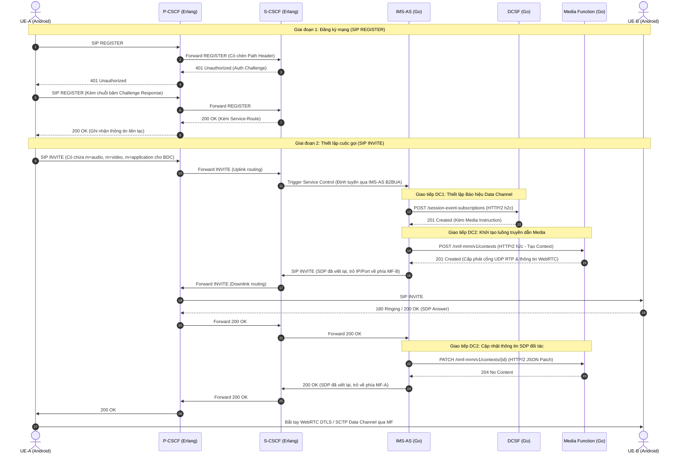

# TÀI LIỆU KỸ THUẬT TỔNG HỢP: HỆ THỐNG IMS DATA CHANNEL (5G NEW CALLING)

Tài liệu này là bản chuẩn hóa duy nhất và chi tiết nhất về toàn bộ dự án **IMS Data Channel Proof-of-Concept (PoC)**. Tài liệu được thiết kế nhằm giúp đội ngũ kỹ sư phát triển (Dev) và vận hành (Ops) hiểu rõ cấu trúc thư mục, kiến trúc các thành phần, luồng báo hiệu viễn thông (Gm, DC1, DC2), hướng dẫn biên dịch ngoại tuyến và quy trình triển khai thực tế trên môi trường RHEL/Kubernetes.

---

## 📂 1. Cấu trúc Thư mục và File Dự án

```text
demo-mini-app/
├── config/
│   └── sys_config.json       ← [Cấu hình tập trung] Mọi thông số domain, cổng, tài khoản IMS.
│
├── go-mf/                    ← Thành phần Golang (DCSF, DCAS, MF, UE-Simulator)
│   ├── cmd/                  ← Điểm khởi chạy của các dịch vụ Go
│   │   ├── dcar/             ← Cung cấp static assets và menu ứng dụng qua HTTP/2
│   │   ├── dcsf/             ← Quản lý session báo hiệu của Data Channel (DC1 interface)
│   │   ├── dcas/             ← Cung cấp WebSocket relay dữ liệu cho Web Simulator
│   │   ├── mf/               ← Media Function xử lý đóng gói RTP, WebRTC PeerConnection
│   │   └── pcap-exporter/    ← API xuất và phân tích file capture PCAP từ ClickHouse
│   ├── internal/             ← Gói logic nghiệp vụ lõi
│   │   ├── imsas/            ← IMS AS B2BUA, SIP parser và HEP client
│   │   ├── mf/               ← Media Function, WebRTC connection, RTP socket loop
│   │   └── uesim/            ← Trình mô phỏng UE phía backend (SIP UA & WebRTC)
│   ├── vendor/               ← [Offline] Thư viện Go được gom sẵn (không cần internet khi build)
│   └── Dockerfile            ← Build offline đa giai đoạn (Alpine-based)
│
├── erlang-sip/               ← Thành phần Erlang SIP Server (S-CSCF/IMS-AS)
│   ├── src/                  ← Mã nguồn Erlang (SIP proxy, registry, DNS, HEP client)
│   ├── local_deps/           ← [Offline] Thư viện Erlang (jiffy, hackney...) dạng source cục bộ
│   ├── rebar.config          ← Cấu hình biên dịch Rebar3 trỏ vào local_deps/
│   ├── rebar3                ← File thực thi Rebar3 đóng gói kèm theo
│   └── Dockerfile            ← Build offline đa giai đoạn (Debian-based có sẵn GCC/Make)
│
├── android-client/           ← Mã nguồn ứng dụng Android Client mặc định (Java/Kotlin)
│   ├── app/src/main/java/...
│   │   ├── sip/              ← SipManager quản lý đăng ký SIP REGISTER/INVITE
│   │   ├── webrtc/           ← WebRtcManager & DataChannelManager quản lý luồng dữ liệu WebRTC
│   │   └── ui/               ← Hoạt ảnh cuộc gọi CallActivity và màn hình chính MainActivity
│   └── build.gradle.kts      ← Gradle build script offline/local
│
└── deploy/                   ← Thư mục tài nguyên triển khai hệ thống
    ├── k8s/                  ← [NEW] Thư mục gom toàn bộ 10 file manifests k8s (.yaml)
    ├── tools/                ← [NEW] Thư mục chứa các công cụ hỗ trợ (precheck, export pcap, start/stop)
    ├── offline-images/       ← Thư mục chứa 14 tệp .tar của các base images đã tải về
    ├── docker-compose.yml    ← File compose chạy stack giám sát cục bộ (qryn, homer, db)
    ├── save_images.ps1/sh    ← Script tự động lưu base images thành file .tar (Windows/Linux)
    ├── push_images.sh          ← Script tự động nạp tar, tag và đẩy lên Registry nội bộ
    └── deploy-offline.sh       ← Script tự động hóa triển khai K8s ngoại tuyến trên RedHat
```

---

## 🏛️ 2. Kiến trúc Hệ thống & Luồng Giao tiếp (Interfaces)

Hệ thống được thiết kế theo đúng kiến trúc **Service-Based Architecture (SBA)** và tuân thủ các đặc tả **3GPP TS 26.114 (Gm interface)**, **TS 29.175 (DC1 interface)** và **TS 29.176 (DC2 interface)**:



### Chi tiết các Giao diện (Interfaces):
1.  **Gm Interface (SIP/SDP)**: Chạy trên UDP/TCP không mã hóa (Port 5060). Giữa điện thoại và P-CSCF. Đảm bảo cấu trúc dòng `m=application` (Data Channel) phải nằm **sau** dòng thoại `m=audio` đầu tiên.
2.  **DC1 Interface (IMS-AS <-> DCSF)**: Giao tiếp dạng Service-Based dùng **HTTP/2 Cleartext (h2c)** (Port 8080). IMS-AS đăng ký nhận sự kiện Mini-App và lấy chỉ thị điều khiển phương tiện (Media Instruction) từ DCSF.
3.  **DC2 Interface (IMS-AS <-> Media Function)**: Điều khiển luồng dữ liệu truyền dẫn dùng **HTTP/2 Cleartext (h2c)** (Port 8081). Sử dụng HTTP POST để tạo context báo hiệu và HTTP PATCH (`application/json-patch+json`) để cập nhật SDP bắt tay.

---

## 💾 3. Thiết kế Cơ sở Dữ liệu & Máy Trạng thái (DB & FSM Design)

### A. Tầng lõi IMS (Erlang Proxy Nodes: P/I/S-CSCF)
Thành phần Erlang lưu trữ thông tin trạng thái cực kỳ nhanh trong RAM sử dụng bảng **ETS (Erlang Term Storage)**:
*   **Bảng `pcscf_contacts`**:
    *   *Cấu trúc*: `{Username, ClientIPStr, ClientPort}` (ETS Set, Public).
    *   *Vai trò*: Lưu thông tin liên lạc thực tế của thuê bao đầu cuối để định tuyến Downlink.
*   **Bảng `pcscf_service_routes`**:
    *   *Cấu trúc*: `{Username, ServiceRouteURI}`.
    *   *Vai trò*: Lưu vết nút S-CSCF đã phân phối cho user nhằm phục vụ chuyển tiếp Uplink.
*   **Bảng `scscf_contacts`**:
    *   *Cấu trúc*: `{Username, authenticated, PathHeader}`.
    *   *Vai trò*: Ghi nhận trạng thái hoàn tất xác thực thuê bao cùng đường dẫn trỏ ngược về P-CSCF.

#### Logic phân loại luồng định tuyến tại P-CSCF (Uplink/Downlink Routing):
Để tránh lỗi NAT (IP nguồn của client bị thay đổi thành IP của Host Gateway `172.18.0.1` trong môi trường Docker), P-CSCF phân loại luồng dựa trên **IP Core mạng** thay vì so khớp IP của danh sách contact:
*   P-CSCF định kỳ phân giải tên miền DNS của các node trung tâm mạng Core (`scscf` và `icscf`) và lưu danh sách IP vào cache.
*   Khi nhận gói tin từ địa chỉ `FromIP`:
    *   `IsFromCore = lists:member(FromIP, ScscfIPs ++ IcscfIPs)`
    *   `IsFromClient = not IsFromCore`
*   Nếu `IsFromClient` là `true`: Bản tin đi từ thiết bị người dùng (Uplink). P-CSCF chèn Path header và đẩy lên S-CSCF.
*   Nếu `IsFromClient` là `false`: Bản tin đi từ tổng đài core (Downlink). P-CSCF tìm contact trong bảng `pcscf_contacts` và chuyển tiếp thẳng xuống client.

---

### B. Tầng Báo hiệu (IMS-AS B2BUA) & Trạng thái Cuộc gọi
Ứng dụng Golang lưu trữ trạng thái phiên trong bộ nhớ RAM được đồng bộ qua `sync.RWMutex`:
*   **Database**: `sessions map[string]*CallSession` (Key là `Call-ID` duy nhất của phiên SIP).
*   **Máy trạng thái cuộc gọi (Call FSM)**:
    ```text
    [IDLE] ──(Nhận INVITE)──> [SETUP: Cấp phát port thô trên MF]
                               │
       ┌───────────────────────┴───────────────────────┐
       ▼ (Bắt tay DC1/DC2 thành công)                   ▼ (Lỗi mạng / Timeout DC1)
    [ESTABLISHED: Thông Data Channel]               [FALLBACK: TS 24.186 Q.9.4.4]
       │                                               │ (Đặt cổng SCTP = 0, chỉ thoại)
       └───────────────────────┬───────────────────────┘
                               ▼ (Nhận BYE / CANCEL / SIP Error)
                            [TEARDOWN: Giải phóng cổng trên MF, xóa Session]
    ```

---

### C. Tầng Truyền tải (Media Function - MF)
*   **Database**: `sessions map[string]*MediaSession` (Key là `SessionID` sinh ngẫu nhiên).
*   **WebRTC ICE (FSM)**:
    *   Theo dõi trạng thái ICE qua hàm `OnICEConnectionStateChange`.
    *   Nếu kết nối rơi vào trạng thái `Failed` hoặc `Disconnected`, MF tự động gọi hàm `CleanupSession` để thu hồi toàn bộ socket UDP, luồng phát video/audio giả lập và giải phóng bộ nhớ RAM để tránh rò rỉ tài nguyên hệ thống.

---

## 🏛️ 4. Quy chuẩn Tích hợp OEM cho Nhà sản xuất Thiết bị (Samsung/GSMA TS.66)

Để làm việc với các nhà sản xuất điện thoại (như Samsung, Apple), đội ngũ lập trình cần nắm rõ các nguyên tắc tích hợp:

### 1. Phân chia Vai trò giữa Nhà mạng và OEM
*   **Nhà mạng / Vendor (Chúng ta)**: Cung cấp hạ tầng mạng lõi (IMS Core, DCSF, DCAS) và thiết kế lớp Mini-App (HTML5/JS). Đồng thời cung cấp mã nguồn SDK tham chiếu (`SipManager.kt`, `WebRtcManager.kt`) để hướng dẫn OEM cách tương tác.
*   **Nhà sản xuất thiết bị (OEM - Samsung)**: Do tính bảo mật của mạng **IMS APN** (yêu cầu quyền hệ thống để định tuyến và áp cấu hình chất lượng dịch vụ ưu tiên QoS QCI-1/2), bên thứ ba không thể tự kết nối. Samsung sẽ tiếp nhận bộ SDK tham chiếu này, nhúng nó vào phân vùng hệ thống (**System-level / Platform Signature**) của ứng dụng Gọi điện mặc định (Dialer) của họ.

### 2. Các ràng buộc bảo mật WebView (GSMA TS.66)
*   **Ràng buộc thời gian sống (Container Lifecycle)**: Trình duyệt chạy Mini-App phải được khởi tạo đồng thời và gắn chặt vào thời gian sống của cuộc gọi thoại. Khi Dialer ngắt cuộc gọi, lớp Native Android phải chủ động gửi lệnh JavaScript dọn dẹp bộ nhớ:
    ```kotlin
    webView.evaluateJavascript("window.cleanUpImsDcObjects();", null)
    ```
*   **Kiểm tra MIME Type nghiêm ngặt**: WebView Interceptor của Android bắt buộc phải chặn và kiểm tra MIME Type của mọi tài nguyên tải về qua kênh Bootstrap Data Channel (BDC). Nếu định dạng file thực tế (ZIP/JS/CSS) không khớp với Content-Type khai báo, SDK sẽ ném ra ngoại lệ `SecurityException` và chặn thực thi lập tức để ngăn ngừa tấn công chiếm quyền Sandbox.

---

## 💻 5. So sánh Giao thức: Giả lập Web Simulator vs. Android App Thật

| Đặc tính | Giải pháp Web Simulator (Browser + Go Backend) | Giải pháp Android Client (Thiết bị thật) |
| :--- | :--- | :--- |
| **Báo hiệu cuộc gọi** | Trình duyệt gửi lệnh WS đến Go Backend. Go Backend hoạt động như một **SIP User Agent (UA)** đại diện gửi gói tin SIP/SDP chuẩn hóa lên mạng IMS Core. | Ứng dụng Android chạy trực tiếp SIP Stack tích hợp, tự tạo gói tin SIP REGISTER/INVITE qua UDP/TCP truyền lên IMS Core. |
| **Kênh dữ liệu (BDC/ADC)** | Được quản lý bởi thư viện WebRTC Go (`pion/webrtc`) chạy trong Go Backend. Go Backend mở các Data Channel SCTP chuẩn hóa (Stream 0/1000/1001) với mạng viễn thông. | Sử dụng **GSMA IMS WebRTC SDK** tích hợp sẵn trong máy. SDK này tự động đàm phán luồng dữ liệu SCTP-over-DTLS trực tiếp giữa thiết bị đầu cuối với DCSF/DCAS. |
| **Giao tiếp Mini-App (Bridge)** | Tệp `sim_phone_core.html` tạo cầu nối polyfill `window._dsbridge` để đón nhận các sự kiện DSBridge từ mini-app và đóng gói chuyển tiếp về Go backend xử lý. | WebView của hệ điều hành Android tự động liên kết các hàm Java Native bằng chú thích `@JavascriptInterface` của DSBridge SDK thật. |
| **Truyền dẫn dữ liệu vẽ (Whiteboard)** | Sử dụng cơ chế HTTP Relay chéo Pod (`/miniapp_relay`) để đồng bộ trạng thái vẽ giữa 2 trình duyệt do hạn chế về kết nối P2P vật lý trên cụm giả lập Kubernetes nội bộ. | Dữ liệu vẽ được đóng gói thành byte thô, mã hóa Base64 và gửi trực tiếp qua luồng dữ liệu SCTP Data Channel ngang hàng (P2P) đi xuyên qua mạng IMS của nhà mạng. |
| **Ràng buộc Bảo mật** | Tuân thủ tuyệt đối: SIP chạy trên nền UDP/TCP không TLS; HTTP/2 Cleartext (h2c) không HTTPS; luồng RTP và SCTP data chạy không mã hóa giúp giám sát Wireshark thuận tiện. | Tuân thủ chính sách tương tự trên các thiết bị đầu cuối và tổng đài thử nghiệm để đảm bảo đồng nhất về mặt giải pháp kỹ thuật. |

---

## 🛠️ 6. Hướng dẫn Biên dịch Ngoại tuyến (Air-Gapped Build)

Quy trình biên dịch hoàn toàn ngoại tuyến, không cần kết nối Internet tại máy chủ xây dựng (Builder):

### A. Biên dịch và Đóng gói Ứng dụng Go (`go-mf`)
Dự án Go sử dụng cơ chế **Go Vendoring**. Mọi thư viện phụ thuộc đã được lưu trữ sẵn trong thư mục `vendor/`.
*   **Dockerfile của Go** sử dụng cờ `-mod=vendor` để bắt buộc Go Compiler đọc mã nguồn cục bộ:
    ```dockerfile
    RUN CGO_ENABLED=0 GOOS=linux go build -mod=vendor -o /ims-as ./cmd/ims-as
    ```
*   **Lệnh build**:
    ```bash
    docker build -t go-mf:local ./go-mf
    ```

### B. Biên dịch và Đóng gói Ứng dụng Erlang (`erlang-sip`)
Erlang SIP đã được cấu hình lại để đọc dependencies cục bộ từ thư mục `local_deps/`:
*   **Cấu hình Rebar3 (`rebar.config`)**:
    ```erlang
    {deps, [
        {jiffy, {raw, {path, "local_deps/jiffy"}}},
        {hackney, {raw, {path, "local_deps/hackney"}}}
    ]}.
    ```
*   **Docker Multi-Stage Build**: Sử dụng ảnh builder `erlang:26.2.3` (Debian-based) vì ảnh này đã tích hợp sẵn công cụ lập trình `gcc` và `make` cần thiết để biên dịch mã nguồn C của dependency `jiffy`, tránh việc phải chạy `apt-get install` hay `apk add` yêu cầu Internet.
*   **Lệnh build**:
    ```bash
    docker build -t erlang-sip:local ./erlang-sip
    ```

---

## ☸️ 7. Quy trình Triển khai Kubernetes trên RedHat (RHEL) Offline

### Bước 1: Chuẩn bị tài nguyên (Tại máy có mạng Internet)
1.  Tải các Base Images và lưu thành file `.tar`:
    *   Trên Windows: Chạy `deploy/save_images.ps1`
    *   Trên Linux: Chạy `deploy/save_images.sh`
2.  File nén đầu ra sẽ nằm ở thư mục `offline-images/`. Nén toàn bộ thư mục `demo-mini-app` và mang sang máy chủ RHEL ngoại tuyến.

### Bước 2: Nạp và Đẩy Images lên Registry Nội bộ (Chạy trên RHEL Offline)
Kết nối với Local Docker Registry của cụm mạng (ví dụ: `10.0.0.10:5000`), thực hiện chạy:
```bash
cd deploy/
chmod +x push_images.sh
./push_images.sh 10.0.0.10:5000
```
Script sẽ tự động giải nén các file `.tar`, gán nhãn tag tương ứng với Registry nội bộ và thực hiện lệnh `docker push`.

### Bước 3: Triển khai Cụm ứng dụng K8s
1.  Xác định card mạng vật lý phụ làm cổng thoại bằng lệnh `ip link` (ví dụ `enp3s0`).
2.  Cập nhật trường `"master"` trong tệp [deploy/k8s-multus-macvlan.yaml](deploy/k8s-multus-macvlan.yaml):
    ```json
    "master": "enp3s0"
    ```
3.  Chạy script cài đặt tự động:
    ```bash
    chmod +x deploy-offline.sh
    ./deploy-offline.sh 10.0.0.10:5000
    ```
Script này sẽ:
1.  Tự động thay thế địa chỉ các image trong toàn bộ file Deployment YAML sang Registry nội bộ của bạn.
2.  Tạo namespace **`demo-mini-app`**.
3.  Triển khai Multus CNI, mạng macvlan, CoreDNS phân giải tập trung và các Pods Core IMS vào đúng namespace `demo-mini-app`.

### Bước 4 (Dành riêng cho Dev Local): Triển khai trên Docker Desktop
Nếu bạn đang chạy trên máy cá nhân có sẵn **Docker Desktop (Kích hoạt Kubernetes)**:
Toàn bộ ngữ cảnh cấu hình (từ Tailscale, Redis, Core IMS đến Telemetry) đã được tích hợp đầy đủ vào thư mục `deploy/k8s/` và cấu hình `imagePullPolicy: IfNotPresent`. Do đó, bạn không cần chạy script phụ, chỉ cần gõ lệnh chuẩn:

```powershell
kubectl create namespace demo-mini-app

# 1. Chạy các thành phần Lõi (IMS, DNS, Redis, Macvlan...)
kubectl apply -f deploy/k8s/core/

# 2. (Tùy chọn) Chạy hệ thống Giám sát & Telemetry
kubectl apply -f deploy/k8s/monitoring/

# 3. (Tùy chọn) Chạy Tailscale Router (nếu cần truy cập từ Internet)
kubectl apply -f deploy/k8s/addons/tailscale/
```

Việc phân tách thư mục này giúp bạn dễ dàng tuỳ chọn thành phần cần cài đặt tùy theo môi trường (ví dụ: Production offline thì bỏ qua Tailscale).

---

## 🔬 8. Hệ thống Giám sát, Khắc phục Sự cố & Trích xuất PCAP

Hệ thống được tích hợp sẵn Sniffer bắt gói tin tự động, HEP Agent chuyển tiếp log và ClickHouse/Grafana để phục vụ gỡ lỗi (Debugging):

### A. Phân tích Bản tin HTTP/2 SBA trên Wireshark
Lưu lượng HTTP/2 Cleartext (h2c) chạy trên cổng `5070` (IMS-AS), `8080` (DCSF) và `8081` (MF) cần được cấu hình đúng cách trong Wireshark để hiển thị chi tiết:
1.  Mở Wireshark -> **Analyze** -> **Decode As...**
2.  Bấm dấu **+** để thêm dòng cấu hình mới:
    *   *Field*: TCP Port
    *   *Value*: `8080` (hoặc `8081`, `5070`)
    *   *Default*: (none)
    *   *Current*: **HTTP2**
3.  Bấm **OK**. Wireshark sẽ tự động giải mã các frame nhị phân, giải nén tiêu đề HPACK và hiển thị đầy đủ cấu trúc JSON API.

### B. Hướng dẫn Truy vấn Log qua Grafana Loki / qryn
Toàn bộ log của các microservices được đẩy về Loki thông qua bộ gom log Fluent Bit. Bạn có thể truy cập Grafana (`http://localhost:3000`) và thực hiện truy vấn:
1.  **Xem log của toàn bộ hệ thống dạng cấu trúc JSON**:
    ```text
    {job="fluent-bit"} | json
    ```
2.  **Lọc log theo mức độ lỗi nghiêm trọng của dịch vụ Media Function**:
    ```text
    {job="fluent-bit"} | json | level="ERROR" and service="mf"
    ```
3.  **Trace vết toàn bộ hành trình cuộc gọi đi qua các Node (Erlang & Go)**:
    ```text
    {job="fluent-bit"} | json | call_id="16xqgkd2o51ddvpy@imsdc"
    ```

### C. Tải File PCAP Capture Sạch
Bạn có thể gọi API của `pcap-exporter` để tự động truy vấn ClickHouse, tạo file PCAP chứa toàn bộ lưu lượng SIP, RTP và HTTP/2 được nhóm theo Call-ID:
```bash
# Tải file PCAP của cuộc gọi dựa trên Call-ID cụ thể
curl -o call_trace.pcap http://localhost:8095/pcap/download?callid=16xqgkd2o51ddvpy@imsdc
```

---

## 🛠️ 9. Lịch sử Phiên bản và Lỗi đã sửa (Version History)

### Phiên bản 4.0.1
1. **Sửa lỗi crash khởi động Erlang do định dạng dòng CRLF**: Ép VM args về LF trong Dockerfile.
2. **Cung cấp macvlan CNI trên Kind Node**: Tải và chuyển gói CNI thủ công vào container Kind.
3. **Sửa lỗi bận ảo (Busy status bug)**: Đặt lại `ue.lastSipInvite = nil` khi hủy/giải phóng cuộc gọi.
4. **Tự động đăng ký khi khởi chạy (Auto-Registration)**.

### Phiên bản 4.0.2
1. **Mạng Calico trên Windows/WSL2**: Động hóa WebSocket proxy qua cấu hình `UE_TARGET_HOST` để bỏ qua lỗi promiscuous mode của card mạng ảo Windows.
2. **ICE Timeout**: Tăng thời gian chờ kết nối ICE từ 15s lên 60s để tránh ngắt cuộc gọi sớm.
3. **HTTP/2 Cleartext**: Ép h2c trong Go HTTP client bằng `http2.Transport{AllowHTTP:true}`.
4. **Sniffer trên cổng any**: Bắt mọi traffic qua bridge ảo và Calico.

### Phiên bản 4.0.3
1. **Giải phóng BDC/ADC trên DC1**: IMS-AS tự động gọi `DELETE /session-event-subscriptions/{subId}` khi kết thúc cuộc gọi.
2. **DCSF Trailing Slash Routing**: Map song song `/session-event-subscriptions` và `/session-event-subscriptions/` để tránh lỗi Redirect 301/Method Not Allowed.

### Phiên bản 6.0.0
1. **Định tuyến Whiteboard chéo Pod (Relay Mechanism)**: HTTP relay chéo Pod qua `/miniapp_relay` để đồng bộ bảng vẽ.
2. **Biến môi trường Callee**: Cấu hình `UE_TARGET_HOST` cho Pod Callee.

### Phiên bản 8.0.0
1. **SDP Renegotiation Bypass**: Tái sử dụng SDP cũ khi nhận Re-INVITE thay vì tạo mới, tránh treo ICE.
2. **In-place Data Channel Recreation**: Tự động mở lại `adc` (stream 1000/1001) khi WebView tắt/mở lại.
3. **Đồng thời 2 luồng Stream (1000/1001)**: Caller và Callee lắng nghe emoji bay và vẽ đồng thời.
4. **Pre-connection TCP**: MF kết nối trước TCP sang DCAS cho Callee thụ động.
5. **Sửa lỗi khóa Mutex**: Khắc phục lỗi mở khóa nhầm mutex gây panic container MF.
6. **ZIP Extraction Path Fix**: Chuẩn hóa tách thư mục con trên Android khi giải nén ZIP từ Windows.
7. **WebView Interceptor Fix**: Sử dụng `currentAppId` cố định để định tuyến chính xác tài nguyên.
8. **Chuẩn hóa ProblemDetails (TS 29.175)**: Các lỗi API từ DCSF/IMS-AS trả về JSON `ProblemDetails`.
9. **Cơ chế MIME Type (TS.66)**: Android Client kiểm tra byte ZIP và file nạp của WebView để chặn tiêm mã độc.
10. **Giải phóng WebView Memory**: Kích hoạt dọn dẹp WebRTC qua JS khi gác máy.

### Phiên bản 9.0.0
Phiên bản này tối ưu hóa độ tin cậy và khả năng tương thích môi trường Production ngoại tuyến của tầng báo hiệu IMS Core, đồng thời sửa triệt để các lỗi đàm phán giao thức HTTP/2 Cleartext và tăng cường độ bền vững của máy trạng thái cuộc gọi khi xảy ra lỗi:

1.  **Chuẩn hóa định dạng phân loại luồng P-CSCF (Production-Ready Routing)**:
    *   *Mô tả lỗi*: Cơ chế cũ dùng hàm `lookup_pcscf_contact` để phân biệt chiều bản tin (Uplink/Downlink) bằng cách so khớp IP nguồn với IP thiết bị đăng ký. Cách này bị lỗi khi chạy qua NAT (IP nguồn bị chuyển thành IP của Host Gateway `172.18.0.1`) hoặc khi xảy ra race condition (gọi điện trước khi tiến trình đăng ký cập nhật xong DB), dẫn đến việc P-CSCF chuyển thẳng bản tin Uplink `INVITE` sang thiết bị Callee mà hoàn toàn bỏ qua S-CSCF và IMS-AS.
    *   *Giải pháp*: Refactor lại hàm `route_pcscf` trong [sip_server.erl](file:///d:/project/demo-mini-app/erlang-sip/src/sip_server.erl). P-CSCF tiến hành phân giải động địa chỉ các node trung tâm Core (`scscf` và `icscf` qua DNS) và kiểm tra nguồn gửi. Nếu `FromIP` thuộc danh sách Core IPs thì bản tin là Downlink; ngược lại là Uplink. Cơ chế này hoàn toàn độc lập với NAT và tương thích hoàn hảo với môi trường K8s Multus Macvlan không NAT ở Production.
2.  **Khắc phục lỗi nghẽn đàm phán HTTP/2 h2c (Middleware Order bug)**:
    *   *Mô tả lỗi*: Trước đây `HEPMiddleware` được bọc ngoài `h2c.NewHandler`. Khi client HTTP/2 gửi chuỗi preface bắt tay (`PRI * HTTP/2.0`), Middleware đã thực hiện `io.ReadAll(r.Body)` trực tiếp từ raw socket, làm mất (consume) mất các frame Settings/Headers đầu tiên của client. Kết quả là lớp `h2c` phía dưới không nhận diện được giao thức và đóng kết nối đột ngột với mã lỗi `unexpected EOF`.
    *   *Giải pháp*: Đổi thứ tự bọc Middleware trên các máy chủ Go ([dcsf.go](file:///d:/project/demo-mini-app/go-mf/internal/dcsf/dcsf.go), [b2bua.go](file:///d:/project/demo-mini-app/go-mf/internal/imsas/b2bua.go), [dcar/main.go](file:///d:/project/demo-mini-app/go-mf/cmd/dcar/main.go), [mf/main.go](file:///d:/project/demo-mini-app/go-mf/cmd/mf/main.go)) thành: `h2c.NewHandler(HEPMiddleware(mux), h2s)`. Cài đặt thêm hai interface bắt buộc của HTTP/2 là `http.Flusher` và `http.CloseNotifier` trên đối tượng ResponseWriter tùy biến `hepResponseWriter` trong [hep.go](file:///d:/project/demo-mini-app/go-mf/internal/imsas/hep.go) để hỗ trợ phân phối frame dữ liệu HTTP/2 mượt mà.
3.  **Tăng cường khả năng chịu lỗi và chạy tiếp (TS 24.186 Graceful Fallback)**:
    *   *Mô tả lỗi*: Khi việc đàm phán giao diện DC1 hoặc DC2 gặp lỗi (ví dụ do timeout mạng), IMS-AS kích hoạt fallback theo chuẩn TS 24.186 (thiết lập cổng SCTP về 0 và tiếp tục thiết lập thoại/video). Tuy nhiên, code cũ trong hàm `handle200OKInvite` của IMS-AS vẫn cố gắng cập nhật context và ghi đè SDP bằng biến `session.MfInfoA` (lúc này đang bị `nil`), gây lỗi `SIGSEGV: segmentation violation` và sập container.
    *   *Giải pháp*: Bổ sung kiểm tra điều kiện an toàn (`if session.ContextID != "" && session.MfInfoA != nil`) trước khi gọi các hàm Patch Context hoặc Rewrite SDP của Media Function trong [b2bua.go](file:///d:/project/demo-mini-app/go-mf/internal/imsas/b2bua.go). Nếu xảy ra lỗi mạng hoặc fallback, cuộc gọi thoại/video tiêu chuẩn vẫn được thiết lập an toàn mà không làm sập container.
4.  **Chụp đầy đủ HTTP Response Body vào PCAP (HEP mirroring)**:
    *   *Giải pháp*: Hoàn thiện giải pháp chụp gói tin Custom HEP (`ProtoType = 100`) trong [hep_client.erl](file:///d:/project/demo-mini-app/erlang-sip/src/hep_client.erl) và [hep.go](file:///d:/project/demo-mini-app/go-mf/internal/imsas/hep.go) để lưu trữ đầy đủ cả Request lẫn Response body (gồm headers, status codes) của các API HTTP/2 và HTTP/1.1 vào ClickHouse để truy xuất và phân tích Wireshark hoàn chỉnh.
5.  **Ghim phiên bản cụ thể cho các công cụ mã nguồn mở (Pin Version Tags)**:
    *   *Giải pháp*: Loại bỏ hoàn toàn việc sử dụng nhãn `:latest` không rõ ràng đối với các image bên thứ ba (qryn, heplify-server, homer-app, grafana-oss, heplify agent). Thay thế bằng các phiên bản cố định ổn định (như `qxip/qryn:1.4.10`, `sipcapture/heplify:v1.65.6`, `grafana/grafana-oss:10.4.2`...) trong các file Docker Compose, file manifest K8s và các script tải lưu offline (`save_images.sh`, `save_images.ps1`, `deploy-offline.sh`), đảm bảo tính nhất quán của hệ thống trong môi trường ngoại tuyến.

### Phiên bản 10.0.0 & 11.0.0 & 12.0.0
1. **Triển khai cụm HA ClickHouse (ClickHouse Keeper)**: Hỗ trợ Cluster HA ClickHouse sử dụng ClickHouse Keeper để lưu trữ logs tập trung an toàn, bền vững khi có instance lỗi.
2. **Triển khai cụm HA Redis (Redis Sentinel)**: Tích hợp cấu hình HA cho Redis thông qua Redis Sentinel bảo đảm tính khả dụng cao của bộ nhớ đệm trạng thái Game.
3. **Triển khai cụm Postgres (Patroni)**: Tích hợp mô hình triển khai Patroni cho Postgres database.
4. **Sửa lỗi race condition gán biểu tượng Caro**: Khắc phục lỗi race condition gán biểu tượng X/O khi kết nối đồng thời từ 2 phía, gán cố định X cho người khởi tạo game.
5. **Tách biệt và cô lập pod E2E test (`tool-test`)**: Tách biệt hoàn toàn container chạy dc-test-tool ra khỏi pods ứng dụng sang một pod riêng biệt (`tool-test`).

### Phiên bản 12.0.1
1. **Giải quyết triệt để lỗi 404 Context Deletion trên MF**: Bổ sung hậu tố `-adc` đồng bộ cho ContextID của luồng ADC cả ở khâu khởi tạo và thu hồi tài nguyên trên Media Function.
2. **Đồng bộ hóa tài nguyên ứng dụng trên DCAR**: Khởi tạo thư mục và tệp metadata `app.json` cho hai alias `whiteboard` và `caro` tương ứng với các subprotocol tiêu chuẩn, tránh lỗi `404 Not Found` hoặc `appId mismatch` khi thiết bị di động truy vấn.
3. **Cơ chế tự động kết nối lại (Retry Mechanism)**: Tích hợp cơ chế tự động thử lại 3 lần cho luồng truy vấn DCAR của DCSF và luồng bắt tay TCP sang DCAS của Media Function, giúp chống chịu trễ mạng hoặc nghẽn DNS.
4. **Tối ưu hóa phân loại log tránh false positive**: Điều chỉnh các dòng log teardown thông thường (như `closed pipe`) và thông báo kết thúc cuộc gọi tiêu chuẩn để tránh tự động nâng cấp thành log `ERROR`.

### Phiên bản 13.0.0
1. **Xử lý quá tải I/O (Probe Cascading)**: Tăng `timeoutSeconds` của liveness/readiness probes trên K8s pods để chống chịu tải đọc/ghi disk cao, tránh tình trạng K8s kill pod đột ngột (Probe Timeout Cascades).
2. **Loại bỏ Vi phạm BUNDLE (a=group:BUNDLE)**: Sửa cấu trúc bản tin SDP của Android Client để ngừng tạo ra thuộc tính gom nhóm trái phép. Luồng Media và DataChannel hoàn toàn tách biệt.
3. **Gỡ bỏ mã hóa SRTP sai chuẩn**: Hạ chuẩn hồ sơ giao vận của Android Client từ `UDP/TLS/RTP/SAVPF` xuống `RTP/AVP`, đồng thời loại bỏ mã hóa PCMU (payload 0) chỉ sử dụng duy nhất chuẩn PCMA và H264 trên UDP thường.
4. **Tuân thủ API Guardrails (TS.66)**: Đồng bộ mã nguồn Kotlin của Android Client (`MergeAdcOffer` và `SplitAdcAnswer`) để khớp hoàn toàn với kiến trúc vận hành cắt/ghép JSEP SDP chuẩn của nhà sản xuất gốc (OEM).

### Phiên bản 14.0.0
1. **Thiết kế Game Caro 9x9 (Tic-Tac-Toe)**: Bổ sung trò chơi Cờ Caro 9x9 tương tác thời gian thực qua giao thức kênh dữ liệu (SCTP Data Channel) với logic thắng/thua/hòa hoàn chỉnh.
2. **Cơ chế Đồng bộ Hóa Trạng Thái Bàn Cờ**: Khắc phục lỗi Race Condition khi 2 người chơi cùng đánh một lúc, áp dụng cơ chế khóa phân tán tại máy chủ qua Redis.

### Phiên bản 14.0.1
1. **Kiểm tra MIME Type Nghiêm Ngặt**: Tích hợp luồng chặn ZIP resource tại `ZipResourceInterceptor.kt`, tự động đọc byte header (Magic Bytes `50 4B 03 04`) thay vì dựa vào phần mở rộng, giúp tăng cường bảo mật tuân thủ GSMA TS.66.
2. **Định dạng Content-Type (HTTP/2)**: Điều chỉnh `dcar` để trả về đúng `application/zip` và các loại MIME Type chuẩn xác cho Web resource.

### Phiên bản 14.0.2
1. **Sửa lỗi Bóc tách App ID trên GSMA SDK (ImsDcSdk.kt)**: Khắc phục lỗi Fallback cứng về TuYaApp do cơ chế parse JSON bị sai lệch khi ứng dụng JS gọi DSBridge với nested parameter.
2. **Cấu trúc JSON Phẳng (Flat JSON)**: Chỉnh sửa luồng gửi thông điệp `createAppDataChannel` trong `dcar/main.go` và `ImsDcSdk.kt` đảm bảo tương thích 100% định dạng của GSMA mà không gây đụng độ.

### Phiên bản 14.0.3 (Hiện tại)
*   **Phiên bản 14.0.0, 14.0.1, 14.0.2**: Di chuyển Erlang SIP từ ETS nội bộ sang Redis Sentinel.
*   **Phiên bản 14.0.3**: Tái cấu trúc thư mục triển khai K8s, cho phép linh hoạt tách biệt Core, Monitoring và Addons (Tailscale). Khắc phục sự cố mất ngữ cảnh khi triển khai trên đa môi trường (Docker Desktop / Production Offline).

---

## 🔬 10. Hướng dẫn Kiểm thử Hệ thống dành cho Nhà phát triển (Developer Testing Guide)

Phần này hướng dẫn chi tiết cách đội ngũ lập trình viên (Dev) vận hành, cấu hình và tiến hành kiểm thử toàn bộ hệ thống từ máy chủ (Server) đến ứng dụng di động (Android Client) và các kịch bản chuẩn đoán lỗi.

### A. Quy trình Vận hành và Biên dịch các Dịch vụ Backend (Server)

Dự án sử dụng Docker Compose để tạo lập môi trường Lab giả lập hoàn chỉnh mạng IMS Core và các SBA Microservices ngay trên máy tính phát triển (Windows/Linux).

#### 1. Các Node Dịch vụ Cốt lõi và Vai trò:
*   **Tầng lõi IMS Core (Erlang - `erlang-sip`):**
    *   `pcscf`: Proxy Call Session Control Function - Điểm tiếp xúc đầu tiên của SIP client. Thực hiện phân loại Uplink/Downlink độc lập NAT và định tuyến.
    *   `icscf`: Interrogating CSCF - Truy vấn thông tin đăng ký (HSS) và tìm kiếm S-CSCF phù hợp.
    *   `scscf`: Serving CSCF - Node xử lý trạng thái đăng ký chính, xác thực bảo mật và phân phối cuộc gọi đến Application Server.
*   **Tầng Microservices SBA & Media (Go - `go-mf`):**
    *   `ims-as`: Application Server hoạt động như B2BUA, đóng vai trò điều phối chính cho cuộc gọi thoại tiêu chuẩn kết hợp gọi ứng dụng (Mini-App).
    *   `dcsf`: Data Channel Session Function - Quản lý đăng ký Mini-App qua giao diện DC1.
    *   `dcas`: Data Channel Application Server - Cung cấp kênh WebSocket trung chuyển thông điệp vẽ/emoji cho trình duyệt giả lập.
    *   `dcar`: Cung cấp giao diện Web và các gói Mini-App `.zip` qua giao thức HTTP/2.
    *   `mf`: Media Function - Đàm phán và xử lý luồng WebRTC PeerConnection (SCTP Data Channel) và chuyển đổi mã hóa thoại RTP.

#### 2. Các Lệnh Điều khiển Môi trường Lab (Chạy tại thư mục gốc dự án):
*   **Build lại toàn bộ mã nguồn**:
    ```bash
    # Biên dịch mã nguồn Go và Erlang thành container local
    docker build -t go-mf:local ./go-mf
    docker build -t erlang-sip:local ./erlang-sip
    ```
*   **Khởi động hệ thống**:
    ```bash
    # Chạy các dịch vụ cốt lõi mạng IMS
    docker compose -f deploy/docker-compose.win.yml up -d
    
    # Chạy hệ thống giám sát ClickHouse, Loki, Homer và Grafana
    docker compose -f deploy/docker-compose.yml up -d
    ```
*   **Tắt hệ thống**:
    ```bash
    docker compose -f deploy/docker-compose.win.yml down
    docker compose -f deploy/docker-compose.yml down
    ```

---

### B. Kịch bản Kiểm thử 1: Giả lập Cuộc gọi trên Web (Web Simulator)

Dành cho nhà phát triển kiểm tra nhanh luồng báo hiệu và vẽ whiteboard mà không cần thiết bị di động vật lý.

1.  **Truy cập Giao diện Giả lập**:
    Mở trình duyệt Web và truy cập địa chỉ: `http://localhost:8082` (Giao diện Web Simulator).
2.  **Khởi tạo cuộc gọi**:
    *   **Caller (Người gọi)** đăng ký với số `111` trên giao diện giả lập.
    *   **Callee (Người nhận)** đăng ký với số `222`.
    *   Nhấp nút **Call** từ phía `111` gọi đến `222`.
3.  **Tương tác Mini-App**:
    *   Sau khi cuộc gọi thoại được kết nối, giao diện whiteboard (bảng vẽ chung) sẽ tự động kích hoạt.
    *   Thực hiện vẽ nguệch ngoạc hoặc nhấp bay các emoji trên màn hình Caller, dữ liệu sẽ được WebSocket relay qua `dcas` hiển thị đồng bộ thời gian thực trên màn hình Callee.

---

### C. Kịch bản Kiểm thử 2: Chạy trên Thiết bị Android Thật (Galaxy S24)

Đây là quy trình kiểm thử thực tế mô phỏng môi trường mạng viễn thông.

#### 1. Biên dịch và Cài đặt Ứng dụng Android:
*   Đảm bảo cả 2 thiết bị S24 đã bật chế độ **Developer Options** và **USB Debugging**, kết nối vào máy tính qua cáp USB.
*   Chạy lệnh để build file APK và nạp tự động lên cả hai thiết bị:
    ```powershell
    # Di chuyển vào thư mục Android Client
    cd android-client/
    
    # Build APK Debug
    ./gradlew.bat assembleDebug
    
    # Nạp APK lên các thiết bị S24 đang kết nối
    & "$env:LOCALAPPDATA\Android\Sdk\platform-tools\adb.exe" devices | Select-String -Pattern "device$" | ForEach-Object {
        $devId = $_.Line.Split("`t")[0]
        Write-Host "Installing to device: $devId"
        & "$env:LOCALAPPDATA\Android\Sdk\platform-tools\adb.exe" -s $devId install -r app/build/outputs/apk/debug/app-debug.apk
    }
    ```

#### 2. Cấu hình và Thực hiện Gọi Thật trên S24:
1.  **Kết nối Mạng**: Đảm bảo 2 điện thoại S24 và máy tính chạy Docker kết nối vào **cùng một mạng Wi-Fi** (máy tính đóng vai trò là SIP Server).
2.  **Thiết lập IP trên App**:
    *   Mở app **IMS DC** trên S24.
    *   Nhấp vào biểu tượng bánh răng **Settings** ở góc trên cùng.
    *   Nhập địa chỉ **IP Wi-Fi của máy tính host** (ví dụ `192.168.1.15`). App sẽ lưu thông số này vào `SharedPreferences` để không bị mất khi khởi động lại.
3.  **Đăng ký tài khoản SIP**:
    *   Thiết bị A đăng nhập với định danh số điện thoại là `111`. Nhấp **Register SIP**. Màn hình hiển thị trạng thái màu xanh: `Registered (111)`.
    *   Thiết bị B đăng nhập số điện thoại là `222`. Nhấp **Register SIP** -> `Registered (222)`.
4.  **Thực hiện Cuộc gọi**:
    *   Trên máy A (`111`), nhập số `222` và nhấp nút **Call (Gọi)**.
    *   Máy B sẽ hiển thị màn hình cuộc gọi đến. Nhấp **Accept (Nghe)**.
    *   *Xác thực*:
        *   **Thoại standard**: Hai thiết bị kết nối đàm thoại RTP thông suốt (sử dụng codec âm thanh **PCMA** chuẩn 3GPP).
        *   **Kích hoạt Mini-App (BDC)**: Lớp Native Android nhận diện luồng dữ liệu ứng dụng, tự động tải gói `TuYaApp_1.0.9.zip` từ máy chủ `dcar` qua BDC, giải nén và mở một WebView Sandbox hiển thị bảng vẽ.
        *   **Tương tác P2P (ADC)**: Mở bảng vẽ chung. Người dùng vẽ trên điện thoại A, dữ liệu tọa độ nét vẽ được truyền trực tiếp bằng giao thức **SCTP thô** đi xuyên qua kênh WebRTC Data Channel (ADC - Stream ID 1000/1001) sang điện thoại B mà hoàn toàn không đi qua máy chủ trung gian. Nét vẽ hiển thị đồng bộ lập tức trên cả 2 điện thoại.

---

### D. Kịch bản Kiểm thử 3: Giả lập Tự động E2E qua CLI (dc-test-tool)

Công cụ `dc-test-tool` được viết bằng Go nhằm tự động hóa hoàn toàn việc kiểm thử từ đầu đến cuối (E2E) các kịch bản tương tác dữ liệu Data Channel mà không cần thiết bị di động thật hay trình duyệt.

#### 1. Các Kịch bản được Hỗ trợ và Cách mô phỏng:
*   **Scenario 1: Bảng vẽ Tương tác & Trò chuyện thả tim (A gọi B, B nghe, A ngắt cuộc gọi)**
    *   *Người dùng*: `1003` gọi cho `1004`.
    *   *Giao thức thoại*: Đăng ký SIP qua TCP, thương lượng thoại RTP (PCMA/H264).
    *   *Kênh dữ liệu*: Đàm phán BDC (Stream 0) và ADC (Stream 1000/1001) độc lập.
    *   *Dữ liệu truyền*: Gửi tọa độ vẽ whiteboard trên Stream 1000 và emoji thả tim trên Stream 1001. Kết thúc bằng lệnh `hangup` từ phía Caller (A).
*   **Scenario 2: Thoại/Video tiêu chuẩn (Voice/Video Only)**
    *   *Người dùng*: `1001` gọi cho `1002`.
    *   *Mô tả*: Kết nối thoại/video thông thường qua RTP, không kích hoạt Mini-App Data Channel.
*   **Scenario 3: Đấu cờ Caro 2 phía (Caro Game)**
    *   *Người dùng*: `1005` gọi cho `1006`.
    *   *Mô tả*: Đăng ký SIP, gửi Re-INVITE đàm phán subprotocol `"caro"` trên Stream 1000. Khởi tạo ván cờ (`new_game`) và thực hiện đi nước cờ đầu tiên (`move`), xác thực Callee nhận trạng thái bàn cờ đồng bộ.
*   **Scenario 4: A gọi B, A huỷ cuộc gọi trước khi B nghe (SIP CANCEL)**
    *   *Người dùng*: `1003` gọi cho `1004`.
    *   *Mô tả*: A bắt đầu gọi, giả lập độ trễ ngắn rồi A lập tức gửi lệnh `cancel` để giải phóng cuộc gọi ở trạng thái đang đổ chuông.
*   **Scenario 5: A gọi B, B từ chối cuộc gọi (SIP REJECT)**
    *   *Người dùng*: `1003` gọi cho `1004`.
    *   *Mô tả*: A bắt đầu gọi, B nhận được yêu cầu kết nối nhưng gửi phản hồi `486 Busy Here` để từ chối (`reject`).
*   **Scenario 6: Bảng vẽ Tương tác - B ngắt cuộc gọi (A gọi B, B nghe, B ngắt cuộc gọi)**
    *   *Người dùng*: `1003` gọi cho `1004`.
    *   *Mô tả*: Tương tự Scenario 1 nhưng khi kết thúc, Callee (B) là bên chủ động gửi lệnh `hangup` để giải phóng tài nguyên.

#### 2. Hướng dẫn Chạy Kiểm thử CLI:
Triển khai chạy công cụ trực tiếp bên trong container `deploy-ims-as-1` thông qua cấu hình tệp kịch bản `test_scenarios.json`:
```bash
# Thực hiện chạy toàn bộ 6 kịch bản kiểm thử tích hợp E2E
docker exec deploy-ims-as-1 /app/dc-test-tool --config=/app/test_scenarios.json
```
*Kết quả đầu ra dự kiến*:
```text
=================================================================
                      TESTING SUITE SUMMARY REPORT               
=================================================================
  Total Assertions Run: 30
  Assertions Passed:    30
  Assertions Failed:    0
  Total Run Duration:   1m29.454s
=================================================================
  [RESULT] ✅ ALL SCENARIOS PASSED SUCCESSFULLY
```

---

### E. Chuẩn đoán Lỗi và Debug cho Dev

Khi cuộc gọi gặp lỗi hoặc dữ liệu mini-app không đồng bộ, dev thực hiện kiểm tra theo các bước sau:

1.  **Xem log hợp nhất (Unified Loki Logs)**:
    Truy cập Grafana dashboard `http://localhost:3000` (đăng nhập: `admin/admin`), chọn tab **Explore** và nhập câu truy vấn LogQL:
    ```text
    # Tìm kiếm toàn bộ log của phiên cuộc gọi dựa vào Call-ID
    {job="fluent-bit"} | json | call_id="<Call-ID-lấy-từ-log-app-android>"
    ```
2.  **Kiểm tra Trạng thái kết nối WebRTC trên Media Function**:
    Xem log container `deploy-mf-1` để xác định trạng thái bắt tay DTLS/ICE:
    ```bash
    docker logs -f deploy-mf-1
    ```
    *Lưu ý trạng thái*: `ICE Connection State changed to connected` là điều kiện bắt buộc để dữ liệu nét vẽ (SCTP) có thể truyền qua lại.
3.  **Bắt gói tin và phân tích PCAP**:
    *   Tải file PCAP lưu trữ đầy đủ luồng báo hiệu SIP, RTP và HTTP/2 của cuộc gọi bị lỗi (endpoint `/pcap`):
        ```bash
        curl -o error_call.pcap "http://localhost:8095/pcap?query=<Call-ID-hoặc-số-điện-thoại>&start=<Unix-Time>&end=<Unix-Time>"
        ```
    *   Mở tệp `error_call.pcap` bằng Wireshark. Thực hiện **Decode As** các cổng `8080` (DCSF), `8081` (Media Function) thành **HTTP2** để nhìn thấy chi tiết cấu hình JSON đàm phán cuộc gọi.


---

## ⚙️ 11. Bảng Cấu hình Tài khoản & Tham số Hệ thống (System Credentials & Configuration)

Dưới đây là bảng tổng hợp các tài khoản mặc định và hướng dẫn cấu hình hạ tầng mạng để dev tra cứu nhanh khi triển khai.

### A. Danh sách Dịch vụ HA và Tài khoản (HA Services & Credentials)

Môi trường Kubernetes sử dụng hoàn toàn tên miền nội bộ (K8s DNS) làm Service Discovery để tự động định tuyến đến các node khả dụng mà không dùng IP cố định:

| Dịch vụ HA | Tên miền DNS nội bộ (Kubernetes) | Tài khoản | Mật khẩu | Cơ chế HA / Ghi chú |
| :--- | :--- | :--- | :--- | :--- |
| **Postgres Primary** | `db.demo-mini-app.svc.cluster.local:5432` | `postgres` / `homer_user` | `homerSeven` | Service không selector trỏ trực tiếp đến Active Primary (Patroni tự động cập nhật Endpoints) |
| **Postgres Read-Only** | `db-replica.demo-mini-app.svc.cluster.local:5432` | `postgres` / `homer_user` | `homerSeven` | Định tuyến đến các bản sao Standby để đọc tải (Selector `role: replica`) |
| **Postgres Headless** | `db-service.demo-mini-app.svc.cluster.local:5432` | `replicator` | `replpassword` | Headless service, sử dụng cho đồng bộ nội bộ giữa các Pods |
| **Clickhouse Cluster** | `clickhouse-server.demo-mini-app.svc.cluster.local` | `qryn` | `demo` | Balancer service tự động phân luồng đọc/ghi 3 node (Ports: `8123` HTTP / `9000` Native) |
| **Clickhouse Keeper** | `clickhouse-service.demo-mini-app.svc.cluster.local:2181` | *(Không)* | *(Không)* | Trình điều phối 3-node đồng thuận (Raft Quorum bầu chọn Leader động) |
| **Redis Sentinel** | `redis-sentinel-service.demo-mini-app.svc.cluster.local:26379` | *(Không)* | *(Không)* | Trích xuất IP Master đang active của nhóm `mymaster` |
| **Redis Pods** | `redis-service.demo-mini-app.svc.cluster.local:6379` | *(Không)* | *(Không)* | Headless service đại diện cụm 3 node StatefulSet |
| **Grafana Dashboard** | `grafana.demo-mini-app.svc.cluster.local:3000` | `admin` | `admin` | Giao diện giám sát tập trung |
| **Homer Dashboard** | `homer-app.demo-mini-app.svc.cluster.local:80` | *(Không)* | *(Không)* | Giao diện phân tích cuộc gọi |


### B. Danh sách Tài khoản IMS Thử nghiệm (Default IMS Accounts)

Cấu hình tài khoản phục vụ đăng ký SIP được định nghĩa tập trung tại tệp [config/sys_config.json](file:///d:/project/demo-mini-app/config/sys_config.json). 
*   **Domain IMS**: `ims.mnc001.mcc452.3gppnetwork.org`
*   **Định dạng IMPU**: `sip:<Username>@ims.mnc001.mcc452.3gppnetwork.org`

| Số điện thoại (Username) | Mật khẩu (Password) | Nhạc chờ video (VRBT) | Ghi chú |
| :--- | :--- | :--- | :--- |
| **1001** | `password1001` | Tắt | Tài khoản Test tiêu chuẩn |
| **1002** | `password1002` | **Bật** | Tự động phát video nhạc chờ khi máy khác gọi đến |
| **1003** | `password1003` | Tắt | Tài khoản Test tiêu chuẩn |
| **1004** | `password1004` | Tắt | Tài khoản Test tiêu chuẩn |
| **1005** | `password1005` | Tắt | Tài khoản Test tiêu chuẩn |
| **1006** | `password1006` | Tắt | Tài khoản Test tiêu chuẩn |

### C. So sánh & Cấu hình Hạ tầng Mạng K8s (Calico vs Macvlan)

Hệ thống hỗ trợ 2 mô hình cấu hình mạng tùy thuộc vào môi trường triển khai thực tế:

#### 1. Môi trường Production Ngoại tuyến (RHEL / Kubernetes Multi-Node) -> Sử dụng **Macvlan**
*   **Mô tả**: Sử dụng **Multus CNI** để gán trực tiếp một card mạng vật lý phụ của server (nằm trong dải mạng thoại APN nội bộ) vào bên trong Pod mà không đi qua lớp dịch địa chỉ NAT của K8s.
*   **Ưu điểm**: Cho phép các thiết bị di động thật (Galaxy S24) kết nối Wi-Fi chuyên dụng có thể gửi gói tin RTP và SCTP trực tiếp đến Pod IP của Media Function.
*   **Cách cấu hình**:
    *   Xác định tên card mạng vật lý phụ trên server RedHat bằng lệnh `ip link`.
    *   Mở tệp [deploy/k8s/k8s-multus-macvlan.yaml](file:///d:/project/demo-mini-app/deploy/k8s/k8s-multus-macvlan.yaml) và sửa giá trị trường `"master"` thành tên card vật lý đó (ví dụ: `"master": "enp3s0"`).

#### 2. Môi trường Local/Lab (Windows / WSL2 / Single-Node VM) -> Sử dụng **Calico**
*   **Mô tả**: Do card mạng ảo của Windows/WSL2 không hỗ trợ cơ chế Promiscuous mode cần có của Macvlan, hệ thống tự động kích hoạt cơ chế **WebSocket Relay**.
*   **Ưu điểm**: Giả lập thông suốt cuộc gọi và truyền dữ liệu vẽ bảng vẽ mà không cần cấu hình phần cứng mạng phức tạp.
*   **Cách cấu hình**:
    *   Mạng Calico nội bộ K8s sẽ quản lý định tuyến chéo Pod.
    *   Node `dcas` đóng vai trò chuyển tiếp (Relay) WebSocket. Lập trình viên chỉ cần gán địa chỉ IP Wi-Fi của máy tính host vào biến môi trường `UE_TARGET_HOST` trong các file deployment để các thiết bị di động thật bên ngoài có thể gửi WebSocket data channel về đúng máy tính chạy Docker.

### D. Vai trò của Tailscale (Lab / Internet Testing) vs Môi trường Production Viễn thông (Telco Network)

> [!IMPORTANT]
> **Khẳng định kiến trúc**: Tailscale **CHỈ ĐƯỢC SỬ DỤNG KHI TEST TỪ XA QUA INTERNET**. Khi triển khai vào mạng Production của nhà mạng viễn thông, **HOÀN TOÀN KHÔNG CẦN VÀ KHÔNG SỬ DỤNG TAILSCALE**.

#### 1. Khi nào CẦN dùng Tailscale? (Môi trường Thử nghiệm / Lab PoC qua Internet)
* **Mục đích**: Dành cho trường hợp kỹ sư muốn kết nối các điện thoại vật lý (như Samsung Galaxy S24) qua sóng 4G/5G thương mại hoặc Wi-Fi văn phòng từ xa vào cụm Kubernetes/Kind chạy cục bộ trên máy tính phát triển.
* **Lợi ích trong Lab**:
  * Vượt qua cơ chế NAT/CGNAT của nhà mạng di động mà **không cần thuê IP Public tĩnh** hay cấu hình Port Forwarding phức tạp trên router văn phòng.
  * Đảm bảo các gói tin SIP UDP `5060` và luồng RTP Audio/Video `40000+` không bị tường lửa trung gian chặn.
* **Thành phần**: Nằm trong thư mục Addon tùy chọn `deploy/k8s/addons/tailscale/` (chỉ deploy khi có nhu cầu test từ xa).

#### 2. Khi nào KHÔNG DÙNG Tailscale? (Môi trường Mạng Lõi Viễn thông Production)
* Trong hạ tầng mạng thực tế của nhà mạng viễn thông (Production Telco Core):
  * **Kết nối trực tiếp qua sóng 5G/LTE**: Điện thoại UE kết nối trực tiếp vào mạng lõi thông qua trạm vô tuyến (gNodeB / eNodeB) và khối User Plane Function (**UPF**) qua APN/DNN chuyên dụng là `ims`.
  * **Đường truyền nội hạt chuyên dụng (N6 / SGi Interface)**: Khối P-CSCF và Media Function (MF) kết nối trực tiếp với UPF qua các subnet IP nội hạt viễn thông.
  * **Luồng dữ liệu thuần 3GPP**: Toàn bộ luồng SIP (Port 5060) và RTP/WebRTC di chuyển trực tiếp giữa `UE ↔ UPF ↔ P-CSCF / MF` thông qua định tuyến mạng nội bộ tốc độ cao mà không có bất kỳ lớp VPN/Tailscale trung gian nào.
* **Kết luận**: Khi đóng gói và bàn giao hệ thống lên cụm Kubernetes Production / OpenShift của nhà mạng, **bỏ qua hoàn toàn thư mục addon `tailscale`**.

---


## ⚙️ 12. Nhật ký Cập nhật & Vá lỗi Hệ thống (System Updates & Bug Fixes)

Dưới đây là danh sách các lỗi nghiêm trọng về đồng bộ vòng đời (lifecycle) cuộc gọi và định tuyến mạng đã được sửa đổi và chuẩn hóa thành công trong hệ thống:

### A. Tích hợp Xử lý `Max-Forwards` (Gm Interface)
* **Mô tả**: Tích hợp kiểm tra và cập nhật trường `Max-Forwards` trong các bản tin báo hiệu SIP theo tiêu chuẩn RFC 3261.
* **Chi tiết sửa đổi**:
  * **Erlang SIP Proxy (S-CSCF/P-CSCF)**: Khi nhận SIP Request, kiểm tra giá trị `Max-Forwards`. Nếu $\le 0$, từ chối trực tiếp bằng mã lỗi `483 Too Many Hops` để tránh vòng lặp vô hạn. Khi chuyển tiếp bản tin (`forward_sip`), tự động trừ giá trị đi 1 đơn vị (hoặc khởi tạo mặc định là `70` nếu chưa có).
  * **Android Client & Go Simulator (uesim)**: Bổ sung header `Max-Forwards: 70` vào toàn bộ các bản tin request tự dựng (`REGISTER`, `INVITE`, `BYE`, `CANCEL`, `ACK`).
  * **Sửa nghẽn đồng bộ**: Khắc phục lỗi nghẽn đồng bộ cụm S-CSCF bằng cách chuyển hàm `dns_discovery:send_msg` sang chạy bất đồng bộ (`spawn`), giải quyết triệt để tình trạng trễ phản hồi `200 OK` (giảm từ 17 giây xuống < 1ms).

### B. Tối ưu hóa Bản tin Trace (Hep De-duplication)
* **Mô tả**: Ngăn chặn tình trạng nhân đôi dữ liệu HTTP/REST (DC1, DC2, N5) hiển thị trong cơ sở dữ liệu ClickHouse và Homer.
* **Chi tiết sửa đổi**: Tắt tính năng tự động ghi log HEP phía Client tại Erlang PCF client (`n5_pcf_client`) và Go RoundTripper client (`HEPRoundTripper`), chỉ giữ lại log tập trung phía Server (`HEPMiddleware`). Kết quả giúp PCAP trace gọn gàng hơn và ghi nhận chính xác 100% IP socket thật.

### C. Khắc phục Lỗi Vòng đời Caro Mini-App trên S24 & Go MF
* **Mô tả**: Sửa lỗi ICE Handshake và kẹt giao diện khi thoát và mở lại game Caro nhiều lần liên tiếp trong cùng một phiên thoại.
* **Chi tiết sửa đổi**:
  * **Đồng bộ Thoát Game**: Sửa lỗi đóng socket sớm ở Media Function, đảm bảo thông tin thoát game `LAUNCH_APP operator-menu` được gửi qua lại thông suốt giúp cả hai máy đồng thời trở về Menu.
  * **Khởi tạo mới WebRTC**: Cấu hình Media Function luôn đóng và giải phóng PeerConnection cũ (`AdcPC`) để khởi tạo mới hoàn toàn với IP/Port và DTLS fingerprint mới khi mini-app được mở lại.
  * **Sửa đè SDP & Lặp Patch**: Sửa lỗi luồng lặp patch trong Go IMS-AS giúp toàn bộ các thay đổi SDP của Caller/Callee đều được cập nhật hoàn chỉnh sang Media Function, tránh tình trạng lỗi `ICE Connection State: FAILED` khi mở game lần thứ hai.

### D. Thiết lập cụm Highly Available (HA) cho Postgres, ClickHouse & Redis
* **Mô tả**: Thiết lập kiến trúc cụm HA thực thụ có khả năng tự động failover và đồng thuận cao cho cơ sở dữ liệu và máy trạng thái game, sẵn sàng cho môi trường thương mại lớn (Production).
* **Chi tiết sửa đổi**:
  * **PostgreSQL HA (Patroni + Kubernetes DCS)**: Triển khai cụm 2 node StatefulSet chạy image Patroni PostgreSQL tự xây dựng (`postgres-patroni:local`). Patroni sử dụng trực tiếp Kubernetes API (Endpoints) làm Distributed Consensus Store (DCS) để thực hiện bầu chọn Leader động. Node chính (Primary) tự động được gán nhãn `role: primary`, node phụ (Standby) được gán nhãn `role: replica` thực hiện đồng bộ streaming WAL thời gian thực. Định tuyến ghi đi qua service selector-less `db` được Patroni tự động cập nhật IP của master động, còn định tuyến đọc đi qua service `db-replica`.
  * **ClickHouse HA (3-Node Keeper Cluster)**: Nâng cấp cụm ClickHouse Server lên StatefulSet 3 node (`clickhouse-server-0`, `-1`, `-2`). Tích hợp dịch vụ ClickHouse Keeper nhúng chạy trên tất cả 3 node, sử dụng cơ chế đồng thuận Raft Quorum (server ID được sinh động từ chỉ mục hostname). Bảo đảm khi có tối đa 1 node bị sập, 2 node còn lại vẫn giữ Keeper online và duy trì khả năng đọc/ghi các bảng Replicated bình thường.
  * **Redis Sentinel HA**: Thiết lập cụm 3 node StatefulSet (`redis-0`, `-1`, `-2`) chạy kèm container sidecar `sentinel` giám sát trên cổng `26379`, tự động chuyển vùng Master khi có node sập.
  * **DCAS-1 Distributed State**: Chạy ứng dụng `dcas-1` ở chế độ Active-Active (2 replicas), đồng bộ trạng thái game Caro qua Redis Sentinel Master và kênh Pub/Sub `dcas:broadcast` chéo Pod thời gian thực.

### E. Hỗ trợ Mini-App do phía Callee (B) Khởi tạo & Sửa Lỗi B2BUA Response Routing
* **Mô tả**: Hỗ trợ đầy đủ trường hợp phía nhận cuộc gọi (Callee B) là bên chủ động mở ứng dụng tương tác (Thả tim / Fun-Calling hoặc Caro) trước.
* **Chi tiết sửa đổi**:
  * **IMS-AS B2BUA (`b2bua_response.go`, `b2bua.go`)**: Lưu `LastCallerReInviteMsg` và `LastCalleeReInviteMsg` trong `CallSession`. Định tuyến chính xác bản tin phản hồi SIP `200 OK` theo transaction CSeq của Callee khi Callee gửi re-INVITE.
  * **Media Function DTLS Role (`sba_handler.go`)**: Khắc phục hiện tượng kẹt DTLS Role Handshake bằng cách tự động cấu hình `DTLSRoleServer` (`a=setup:passive`) trên Answer SDP của MF khi Callee gửi Offer, đảm bảo điện thoại Android của Callee đóng vai trò `active` (DTLS Client) và chủ động gửi DTLS `ClientHello`.
  * **HTML/JS Web Console (`callee.html`, `caller.html`, `index.html`)**: Đồng bộ giao diện điều khiển và các sự kiện gửi/nhận sticker Emoji trên cả 2 máy.

### F. Truyền nhận Video 2 chiều (H.264 RTP) & Tinh chỉnh Giao diện Màn hình Nhận Cuộc gọi (Tag v15.0.0)
* **Mô tả**: Hoàn thiện luồng truyền thông Video 2 chiều độ trễ thấp và tinh gọn trải nghiệm người dùng trên thiết bị thật Samsung Galaxy S24.
* **Chi tiết sửa đổi**:
  * **RTP Media Sockets (`RtpMediaManager.kt`)**: Khởi tạo `DatagramSocket` với thuộc tính `reuseAddress = true` giải quyết triệt để lỗi `java.net.BindException: EADDRINUSE` khi tái sử dụng socket video/audio.
  * **Dynamic Video Pipeline (`RtpMediaManager.kt`, `CallActivity.kt`)**: Tích hợp cơ chế đồng bộ gắn `SurfaceView` động qua `SurfaceHolder.Callback` giúp `MediaCodec` AVC Decoder và Video Sender tự động kích hoạt mượt mà ngay khi Surface sẵn sàng.
  * **Tối ưu Giao diện Nhận Cuộc gọi (`activity_call.xml`, `CallActivity.kt`)**: Loại bỏ các nội dung text không cần thiết, loại bỏ các nút phụ đè lấn giao diện; màn hình nhận cuộc gọi chỉ gồm 2 nút chuẩn: Từ chối (Đỏ) và Trả lời (Xanh). Ẩn hoàn toàn khung video xem trước cho đến khi người dùng bấm Trả lời.

### G. Chuẩn hóa Biểu tượng Ứng dụng Samsung One UI 6.1 (Tag v15.0.1)
* **Mô tả**: Tái tạo và chuẩn hóa 100% biểu tượng ứng dụng "Điện thoại" theo ngôn ngữ thiết kế One UI 6.1 trên dòng máy Samsung Galaxy S24 thật.
* **Chi tiết sửa đổi**:
  * **Trích xuất & Tái tạo Hình học One UI**: Trích xuất trực tiếp hình dạng ống nghe chữ `C` đặc trưng của trình quay số Samsung từ ảnh chụp màn hình máy S24 thật, áp dụng giải thuật làm mịn biên dạng Gaussian Kernel Circular Convolution (2048x2048 supersampling) để loại bỏ răng cưa và giữ đúng tỷ lệ hình học.
  * **Tài nguyên Đa Mật độ (Mipmap) & Adaptive Icon**: Cung cấp trọn bộ tài nguyên icon độ phân giải cao cho tất cả các mật độ màn hình (`mdpi`, `hdpi`, `xhdpi`, `xxhdpi`, `xxxhdpi`) kết hợp cấu hình Adaptive Icon (`mipmap-anydpi-v26/ic_launcher_phone.xml`) với dải màu gradient xanh lá emerald One UI (`#00B95B` -> `#00A145`).

### H. Cấu hình Thời gian Đổ chuông & Khắc phục Timeout ICE Media Function (Tag v15.0.1)
* **Mô tả**: Sửa lỗi bên gọi (Caller) bị mất kết nối kênh dữ liệu BDC khi bên nhận (Callee) đổ chuông lâu, đồng thời hỗ trợ cấu hình động thời gian chờ kết nối ICE.
* **Chi tiết sửa đổi**:
  * **Khắc phục ICE Timeout sớm**: Thay thế timeout cứng 5s trên Media Function bằng cơ chế đọc động đa tầng, bảo đảm phiên ICE của bên gọi vẫn duy trì sẵn sàng trong suốt thời gian đổ chuông.
  * **Tham số Cấu hình Mặc định 45s**: Bổ sung tham số `ringing_timeout_sec: 45` trong `sys_config.json` và `Config.Services.Mf.RingingTimeoutSec`, hỗ trợ ghi đè linh hoạt qua biến môi trường `MF_RINGING_TIMEOUT_SEC` / `RINGING_TIMEOUT_SEC`.

### I. Xử lý Cuộc gọi Đến khi Màn hình Đang Tắt & Đánh thức Khóa Màn hình (Tag v15.0.2)
* **Mô tả**: Bảo đảm điện thoại tự động bật sáng màn hình và mở trực tiếp giao diện cuộc gọi đến toàn màn hình ngay khi có cuộc gọi SIP tới trong trạng thái máy đang tắt màn hình hoặc rơi vào chế độ tiết kiệm pin sâu (Deep Doze).
* **Chi tiết sửa đổi**:
  * **Đánh thức Thiết bị & Bỏ qua Khóa Màn hình**: Tích hợp đồng bộ `WakeLock` (`PROXIMITY_SCREEN_OFF_WAKE_LOCK`, `SCREEN_BRIGHT_WAKE_LOCK` kết hợp cờ `ACQUIRE_CAUSES_WAKEUP`), gọi `setTurnScreenOn(true)`, `setShowWhenLocked(true)` và `KeyguardManager.requestDismissKeyguard()` trong `CallActivity` và `CallNotificationManager`.
  * **Kiểm chứng Thực tế**: Đo lường trên máy Samsung Galaxy S24 vật lý, hệ thống đánh thức màn hình từ trạng thái `DOZE_SUSPEND` chỉ sau 1.57 giây, hiển thị màn hình cuộc gọi đến với đầy đủ thông tin người gọi và nút trượt trả lời.

### J. Nút Trượt Trả lời Cuộc gọi (Slide-to-Answer UX) & Đồng bộ 2 Chiều Trọn gói 3 Mini-Apps (Tag v15.0.2)
* **Mô tả**: Nâng cấp giao diện nhận cuộc gọi chuẩn One UI bằng cử chỉ vuốt/trượt, bổ sung âm báo hồi chuông (Ringback tone) và đồng bộ hóa tương tác 2 chiều cho toàn bộ hệ sinh thái 3 ứng dụng Mini-App.
* **Chi tiết sửa đổi**:
  * **Widget SlideToAnswerView**: Xây dựng widget tùy biến `SlideToAnswerView` thay thế nút bấm tĩnh cũ. Widget sở hữu tay cầm vòng tròn xanh phát sáng, hiệu ứng đường trượt (track trail) mờ dần, xử lý cảm ứng vuốt mượt mà kèm cơ chế tự động trả về vị trí cũ (snap-back) nếu chưa kéo qua ngưỡng kích hoạt.
  * **Trạng thái Cuộc gọi & Tone Tút tút**: Phía Caller hiển thị trạng thái "Đang kết nối..." khi vừa bấm gọi; chỉ khi nhận được bản tin SIP `180 Ringing` mới chuyển sang "Đang đổ chuông..." đồng thời tự động phát âm báo hồi chuông chuẩn viễn thông qua `ToneGenerator.TONE_SUP_RINGTONE`.
  * **Bảng vẽ TuYaApp 2 Chiều (`sketch-sync-app`)**: Tự động nhận diện phần tử DOM canvas (`canvas.whiteboard`), căn chỉnh tỷ lệ phân giải và đồng bộ nét cọ 2 chiều (nét ĐỎ máy A + nét XANH LÁ máy B) qua kênh WebRTC ADC (Stream ID 1000).
  * **Game Cờ Caro 9x9 (`caro`)**: Bàn cờ 9x9 đối kháng thời gian thực, đồng bộ hóa nước đi (X/O) và máy trạng thái hiển thị lượt chơi ("Lượt của bạn" / "Đợi đối thủ").
  * **Fun Calling (`fun-calling-app`)**: Thanh tương tác 5 biểu cảm (❤️, 👍, 😊, 😡, ✋) và thông báo toast nhận biểu cảm thời gian thực đè trên nền video trực tiếp.

### K. Tổng đài 198 – Dịch vụ tự phục vụ (app id `smart-menu`, app v2.0.0)
* **Mô tả**: Gọi **198** là mở ngay một app tự phục vụ trong cuộc gọi (kịch bản GSMA 5G New Calling "enterprise hotline"): khách tự xem số dư/data, đăng ký gói, tra cước và nạp tiền, báo sự cố mạng. Không chuyển tổng đài viên. Thay thế hoàn toàn Smart Menu cũ (lời chào tổng đài viên, video hoạt hình, giờ hệ thống).
* **Luồng**: IMS-AS/DCAS trả lời 198 (UAS), BDC nạp app `smart-menu` từ DCAR, ADC stream 1000 (P2A). Trang gửi `{"service":"smart-menu","action":...}`, DCAS (`go-mf/internal/dcas/selfcare_198.go`) trả lời.
* **4 chức năng** (`go-mf/static/apps/smart-menu/index.html`): Trang chủ (thuê bao, tài khoản chính + HSD, data còn lại), Gói cước & data (SPEED120 / MAX90 / DAY10), Cước & thanh toán (cước tháng tạm tính, nạp 50k/100k/200k), Báo sự cố mạng (chọn vấn đề, địa điểm nhập tay, mô tả tùy chọn, danh sách phản ánh trước).
* **Thông điệp ADC 1000**:

  | action | trường gửi | trả lời (`status` = `ok` / `error`) |
  |---|---|---|
  | `profile` | – | `account`, `packages`, `reports` |
  | `subscribe` | `code` | `txn`, `account`, `receipt` · lỗi `insufficient_balance`, `unknown_package` |
  | `topup` | `amount` (50000/100000/200000) | `txn`, `account`, `receipt` · lỗi `bad_amount` |
  | `report` | `issue`, `location`, `note` | `ticket`, `reports` · lỗi `missing_field` |
  | khác | – | lỗi `unknown_action` |

* **Dữ liệu theo thuê bao**: DCAS giữ một tài khoản cho mỗi số gọi đến (lấy từ phiên IMS-AS, không xác định được thì dùng chung `guest`), trong bộ nhớ, mất khi DCAS khởi động lại. Tài khoản mới: 148.500đ, gói MAX90, data 3,2/5 GB, cước tháng 86.400đ, một phản ánh cũ #PA-20431. Đăng ký gói trừ tiền, cộng vào cước tháng, đặt lại data theo gói; nạp tiền chỉ cộng số dư.
* **Chống trừ tiền 2 lần**: mỗi lần bấm, trang gửi kèm `req_id`, DCAS trả lại `req_id`. Bấm thử lại sau khi hết 8 s chờ thì dùng lại `req_id` cũ, nên DCAS gửi lại kết quả cũ chứ không trừ tiền thêm lần nữa. Kết quả đến muộn chỉ cập nhật số liệu, không chuyển màn hình.
* **Định tuyến stream 1000**: chỉ `service:"smart-menu"` vào app 198; caro / enterprise-callerid / flight-booking và draw/clear giữ nguyên; payload khác bị bỏ qua (có log).
* **Kiểm thử**: `cd go-mf && go test ./internal/dcas/ -run 'Selfcare|SmartMenuRouting'`. Android không đổi.


